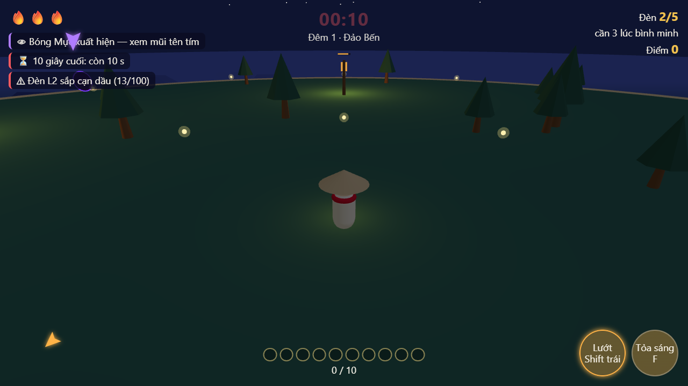

# Đảo Đèn Lồng

> **Video demo:** [demo (mp4)](https://github.com/vankd2307/K5-L3A-DAY12-KieuDinhVan-2A202603376-AI-SDLC-Dao-Den-Long/releases/download/v1.0.0/2026-11-20.22-46-35.mp4) · Bản chạy được: [Release v1.0.0](https://github.com/vankd2307/K5-L3A-DAY12-KieuDinhVan-2A202603376-AI-SDLC-Dao-Den-Long/releases/tag/v1.0.0)

Game 3D góc nhìn thứ ba (TypeScript + Three.js + Vite). Mây, người giữ đèn nhỏ tuổi, đi qua 3 đêm trên 3 hòn đảo. Cô gom đom đóm để thắp và giữ các Đèn Lồng Lớn cháy tới bình minh, né Bóng Mực trong sương đen.



## Yêu cầu hệ thống

| | Tối thiểu |
|---|---|
| Hệ điều hành | Windows 10/11, macOS 12+, Linux 64-bit |
| Node.js | **22 trở lên** (để cài và chạy; bench dùng `WebSocket` có sẵn của Node 22) |
| Trình duyệt | Chrome, Edge hoặc Firefox bản mới, có WebGL2. **Bench** cần Chrome, Chromium hoặc Edge |
| Máy | GPU tích hợp là đủ (đã đo trên Intel UHD của i5-11400H: trung bình 135 fps ở cảnh bench), RAM 4 GB |

## Cài đặt và chơi (3 lệnh)

```bash
git clone https://github.com/vankd2307/K5-L3A-DAY12-KieuDinhVan-2A202603376-AI-SDLC-Dao-Den-Long.git && cd K5-L3A-DAY12-KieuDinhVan-2A202603376-AI-SDLC-Dao-Den-Long
npm ci
npm start        # mở game trong trình duyệt: http://localhost:5173
```

Không muốn cài Node? Tải `dao-den-long-v1.0.0-web.zip` trong [Release v1.0.0](https://github.com/vankd2307/K5-L3A-DAY12-KieuDinhVan-2A202603376-AI-SDLC-Dao-Den-Long/releases/tag/v1.0.0), giải nén, rồi phục vụ thư mục bằng một web server tĩnh bất kỳ, ví dụ `npx serve dao-den-long` hoặc `python -m http.server -d dao-den-long`, và mở địa chỉ nó in ra. Mở trực tiếp `index.html` bằng `file://` sẽ **không** chạy được, vì trình duyệt chặn module JS. Ở bản tĩnh, bảng xếp hạng lưu trong trình duyệt.

## Các lệnh

| Lệnh | Việc |
|---|---|
| `npm start` | Mở game (`run_cmd`). Thêm `-- --export-leaderboard out.json` để xuất bảng xếp hạng ra `{"entries":[...]}` |
| `npm test` | 104 test: luật game, dầu đèn, Test Contract, CLI, bench, soak, bảng xếp hạng, đổi phím, cỡ chữ |
| `npm run typecheck` | Typecheck, kèm kiểm tra riêng rằng `src/core` không dùng DOM/three/Node |
| `npm run bench -- --seed 42 --duration 30 --out bench.json` | Benchmark (`bench_cmd`), xem bên dưới |
| `node --expose-gc --import tsx src/headless/soak.ts --seed 7 --nights 10 --out soak.json` | Soak test (`soak_cmd`, hoặc `npm run soak -- ...`) |
| `node --import tsx src/headless/cli.ts ...` | Chế độ headless (`headless_cmd`) |
| `npm run build` | Build bản web tĩnh vào `dist/` |
| `npm run autoplay -- <seed> <out.json> [night]` | Bot tự chơi một đêm và ghi ra file inputs |

Tham số URL khi thử nghiệm: `?night=2` vào thẳng một đêm, `&scenario=<JSON theo contract>` dựng sẵn tình huống, `&instant` hiện màn kết quả ngay, `&cb` / `&motion` / `&large` bật bảng màu dễ phân biệt / giảm chuyển động / chữ lớn cho lần mở đó (không lưu), `?screen=board|settings` mở thẳng màn hình đó.

## Điều khiển (đổi được trong Cài đặt)

| Phím mặc định | Hành động |
|---|---|
| W A S D | Đi tới / sang trái / lùi / sang phải (theo hướng camera) |
| Space | Nhảy |
| Shift trái | Lướt (14 m/s trong 0.2 s, hồi chiêu 1.5 s) |
| E | Tương tác: nạp đom đóm vào đèn, châm dầu |
| F | Tỏa Sáng: tốn 3 đom đóm, làm choáng và đẩy lùi Bóng Mực trong bán kính 5 m |
| Esc | Tạm dừng: Tiếp tục / Chơi lại Đêm / Cài đặt / Về menu |
| ← → hoặc kéo chuột | Xoay camera |

**Cài đặt** (được lưu lại): âm lượng, độ nhạy chuột, **đổi phím** cho mọi hành động (gán trùng thì bị từ chối và báo phím đó đang dùng cho hành động nào; có nút **Khôi phục mặc định**), **Bảng màu dễ phân biệt**, **Giảm chuyển động** (tắt rung camera, chớp màn hình khi trúng đòn, nhấp nháy đồng hồ và nhân vật), **Chữ lớn** (×1.25; chữ thường đã ≥ 18 px ở 1280×720).

**Phụ đề / chỉ báo hình ảnh** ở góc trên bên trái: Bóng Mực xuất hiện (kèm **mũi tên tím** chỉ tới nó ở mép màn hình), gió sắp nổi (đếm ngược), 10 giây cuối, đèn có dầu < 30.

## Bảng xếp hạng

Sau màn Bình Minh (thắng Đêm 3) hoặc sau khi thua ở bất kỳ Đêm nào, bạn nhập tên (3–12 ký tự: chữ, số, `_`, được gõ tiếng Việt có dấu) để lưu **tổng điểm các Đêm đã thắng**. Giữ top 10, xếp theo điểm giảm dần; bằng điểm thì ai đạt trước đứng trên. Mỗi mục có `name`, `score`, `nights_won`, `achieved_at` (ISO 8601 có múi giờ), `seed`. Khi chơi qua `npm start`, bảng nằm ở `~/.dao-den-long/leaderboard.json` (đổi chỗ bằng biến `DDL_DATA_DIR`), nên vẫn còn sau khi tắt mở lại. Menu chính có nút **Bảng xếp hạng**.

## Benchmark và soak test (Contract v1.3)

```bash
npm run bench -- --seed 42 --duration 30 --out bench.json
node --expose-gc --import tsx src/headless/soak.ts --seed 7 --nights 10 --out soak.json
```

- **Bench** build bản web, mở Chrome đã cài trên máy thành **cửa sổ thật có vùng vẽ 1280×720** (không toàn màn hình). **Vsync đã tắt** bằng cờ `--disable-gpu-vsync --disable-frame-rate-limit`, và chỉ số đo được vượt 60 fps chứng tỏ cờ có tác dụng. Cảnh đo là Đêm 1 với đủ hiệu ứng, đúng 200 Bóng Mực `wander` và 100 đom đóm rải đều theo seed, L1–L3 sáng với dầu 100. Trong cảnh này không sinh thêm thực thể, không sát thương, không nhặt, không hao dầu, không kết thúc Đêm. Camera bay vòng bán kính 30 m, cao 15 m, 15 s một vòng. Đo sau 3 s khởi động, rồi tự thoát với mã 0. Chrome ở chỗ khác thì dùng `--chrome <path>` hoặc `CHROME_PATH`. **Đừng đóng cửa sổ Chrome trong ~35 s đo.**
- `peak_mem_mb` là tổng RSS của cả cây tiến trình Chrome (browser + GPU + renderer). `load_ms` tính từ lúc tiến trình bench khởi động tới khung hình đầu tiên của cảnh bench.
- **Soak** chạy 10 Đêm (1 → 2 → 3 xoay vòng) trong một tiến trình Node. Đêm thứ i (i = 1..10) dùng seed `7 + i`, input ngẫu nhiên theo seed. `mem_start_mb` đo sau khi tải xong Đêm đầu, `mem_end_mb` đo sau khi reset xong Đêm cuối.
- Kết quả đã chạy trên máy tôi: [bench.json](bench.json), [soak.json](soak.json). Chi tiết trong [bằng chứng Phase 4](docs/proof/phase-4/README.md).

## Ba đêm

| Đêm | Đảo | Đèn (cần sáng lúc bình minh) | Thời gian | Điểm mới |
|---|---|---|---|---|
| 1 | Đảo Bến | 5 (3) | 4:00 | Đảo tròn |
| 2 | Đảo Cau | 6 (4) | 4:30 | Hai đảo nối bằng cầu tre, bục nhảy, Gió Lạc, Bùa Gió |
| 3 | Đảo Chuông | 7 (5) | 5:00 | 3 tầng, dốc, bục nhảy lên đỉnh, tháp chuông, gió mạnh |

**Mục tiêu (Ticket-03): giữ đảo sáng tới bình minh.** Thắp hết đèn không kết thúc đêm. Thắng khi còn Ngọn Lửa lúc hết giờ và số đèn đang sáng ≥ 60% (3/5, 4/6, 5/7).
- Mang tối đa 10 đom đóm, +2 sau mỗi lần thắp thành công (tối đa 20). Đèn cần 10 đom đóm để thắp lần đầu, 5 để thắp lại.
- Đèn sáng hao 1 dầu/giây (tối đa 100) và tắt khi cạn. Bấm E ở đèn đang sáng để châm dầu: mỗi đom đóm +10 dầu.
- Bị Bóng Mực chạm: mất 1 Ngọn Lửa (có 3), rơi một nửa số đom đóm đang mang ra đất (nhặt lại được trong 8 s), rồi được bất tử 1.5 s.
- Rơi khỏi đảo: mất 1 Ngọn Lửa và toàn bộ đom đóm, hồi sinh ở điểm xuất phát.
- Đèn đang sáng với dầu ≥ 30 tạo vùng an toàn bán kính 6 m mà Bóng Mực không vào được. Dầu < 30 thì đèn nhấp nháy, mất vùng an toàn, và Bóng Mực kéo tới hút 5 dầu/giây.
- Gió Lạc chỉ để ý khi Mây mang từ 5 đom đóm trở lên, và cướp tối đa 3 con. Tỏa Sáng làm chúng bỏ chạy hoặc thả lại đồ đã cướp.
- Bùa Gió: trong 10 s chạy 7.2 m/s và lướt không cần hồi chiêu.

### Cách tính điểm

| Sự kiện | Điểm |
|---|---|
| Mỗi đom đóm nạp vào đèn (thắp, thắp lại, châm dầu) | +5 |
| Thắp lần đầu / thắp lại | +100 / +40 |
| Mỗi Bóng Mực trúng Tỏa Sáng | +5 (+15 nếu nó đang hút dầu) |
| Khi thắng đêm: mỗi đèn đang sáng | +50 + số dầu còn lại |
| Khi thắng đêm: mỗi Ngọn Lửa còn lại | +50 |

Tổng điểm game là tổng điểm các đêm đã thắng. Thua thì chơi lại đêm đó.

## Chế độ headless (Test Contract v1.3)

Khai báo trong [game.contract.json](game.contract.json):

```bash
npm ci
node --import tsx src/headless/cli.ts --seed 1 --night 1 --ticks 3600 --out out.jsonl \
     [--scenario s.json] [--inputs i.json|i.jsonl] [--snapshot-every 60]
```

- `--night` nhận 1, 2, 3. Mặc định `--snapshot-every` là 60. Lúc kết thúc luôn có một snapshot cuối, rồi tới dòng `end`. Sự kiện `night_start` ghi ở tick 0.
- File `--inputs` nhận cả `{ "frames": [...] }` lẫn JSONL.
- Mã thoát: `0` là thành công; `2` là sai tham số hoặc file sai định dạng; `1` là lỗi khác.
- Snapshot có thêm trường `score`, ngoài các trường contract yêu cầu.

Kiến trúc: toàn bộ luật nằm trong [src/core/](src/core/), viết bằng TypeScript thuần, bước thời gian cố định 60 tick/giây, RNG có seed. Số chuẩn ở [tuning.ts](src/core/tuning.ts), bản đồ chuẩn ở [maps.ts](src/core/maps.ts). Bản web ([src/render/](src/render/)) và CLI cùng chạy một class `Game`. Thứ tự 12 bước của một tick nằm trong `Game.step()`.

## Bằng chứng và ghi chép

- Bằng chứng: [Phase 1](docs/proof/phase-1/README.md) · [Phase 2](docs/proof/phase-2/README.md) · [Phase 3](docs/proof/phase-3/README.md) · [Phase 4](docs/proof/phase-4/README.md)
- Spec Phase 2: [docs/notes/spec-phase-2.md](docs/notes/spec-phase-2.md) · Quyết định thiết kế Phase 3: [ADR 0001](docs/adr/0001-lantern-fuel-and-dawn-win.md) · Phase 4: [ADR 0002](docs/adr/0002-bench-soak-leaderboard.md) · [CHANGELOG](CHANGELOG.md) · [CREDITS](CREDITS.md) · [LICENSE](LICENSE) (MIT)
- Giả định: [docs/notes/assumptions.md](docs/notes/assumptions.md)
- Nhật ký dùng AI: [docs/notes/ai-log.md](docs/notes/ai-log.md) · Retro: [docs/notes/retro.md](docs/notes/retro.md)
- Harness AI: [CLAUDE.md](CLAUDE.md), skill [.claude/skills/verify-phase/](.claude/skills/verify-phase/SKILL.md)

## Sáng tạo của tôi

- Lời dẫn của Ông Đăng mở đầu mỗi đêm. Màn Bình Minh có lời cảm ơn.
- Đèn lồng nhỏ treo trên nón lá của Mây sáng hơn khi mang nhiều đom đóm. Mây nhấp nháy trong lúc bất tử.
- Toàn bộ âm thanh tổng hợp bằng WebAudio (nhạc ngũ cung, tiếng gió, tiếng chuông đếm ngược), không dùng file ngoài.
- Lá bay báo trước cơn gió ở Đêm 3. Đom đóm rơi nhấp nháy trước khi tan.
- Biển mây, cây, sao chỉ để trang trí, nằm ở phần hiển thị nên không ảnh hưởng đầu ra headless.
- Có bot tự chơi (`npm run autoplay`) để kiểm chứng.
- Rung camera nhẹ khi bị Bóng Mực đánh trúng (Phase 4). Tắt được bằng **Giảm chuyển động**.
