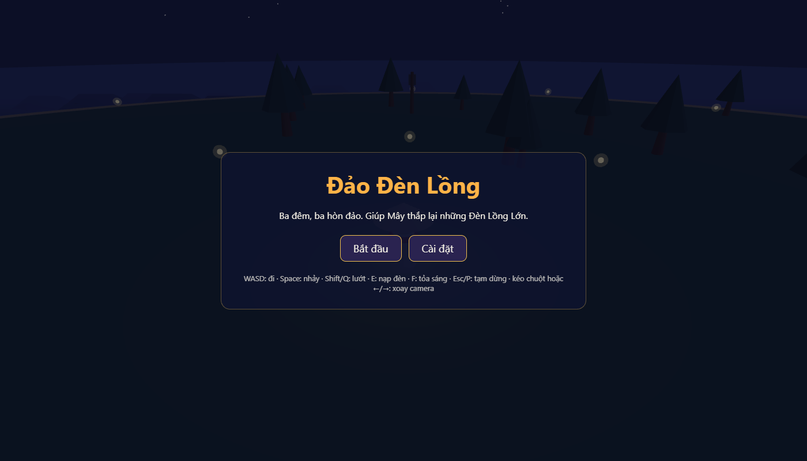
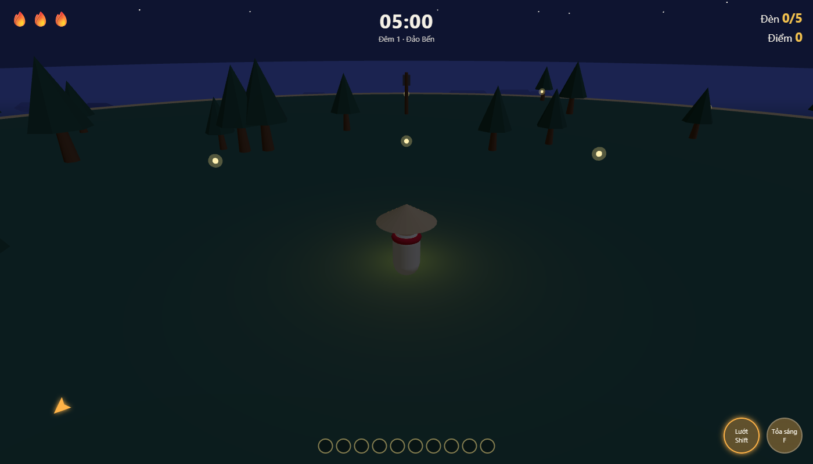
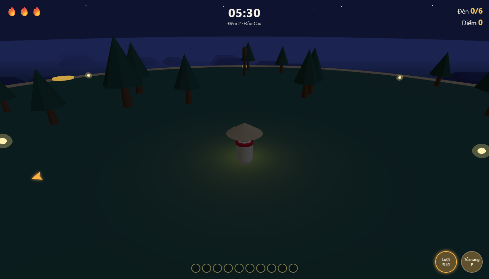
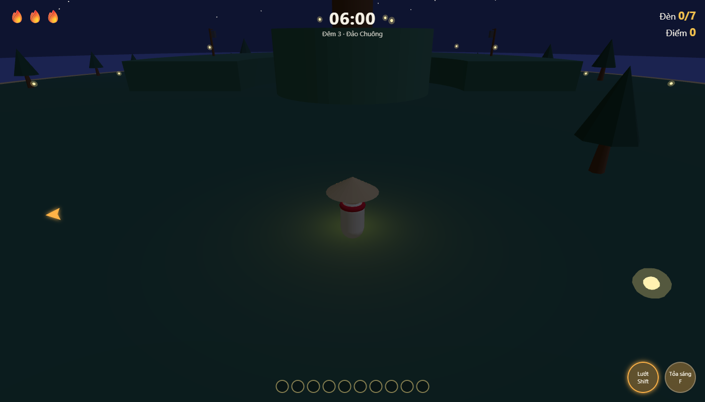
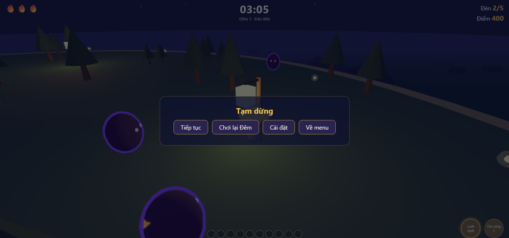
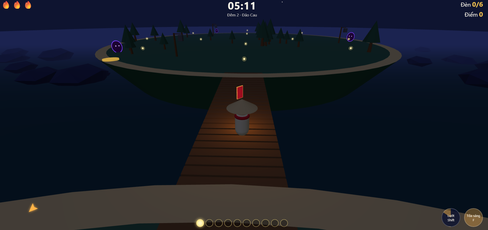
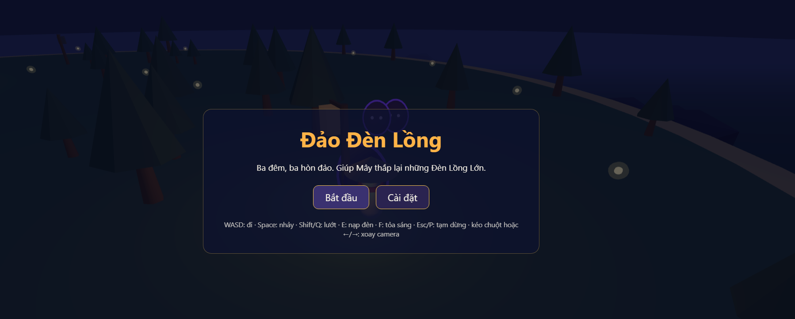
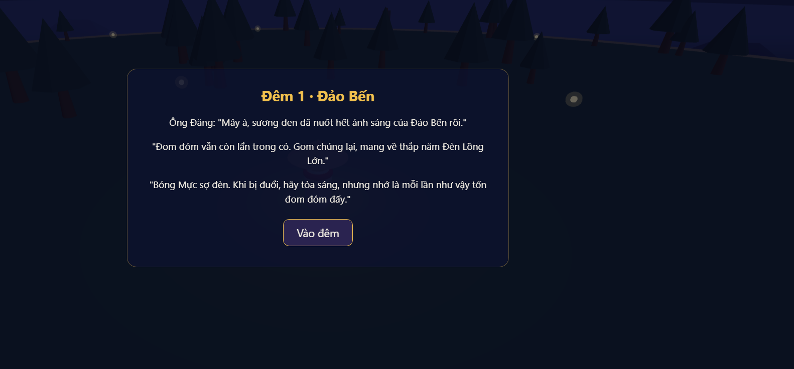
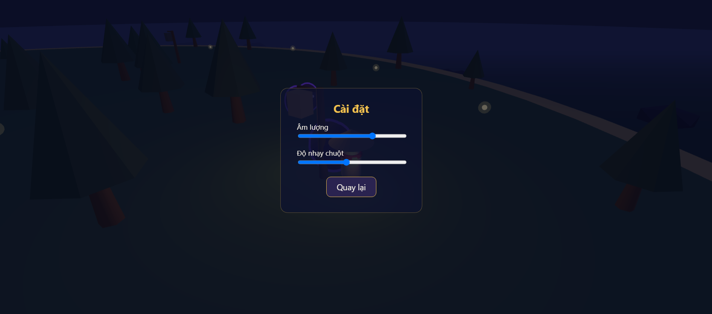
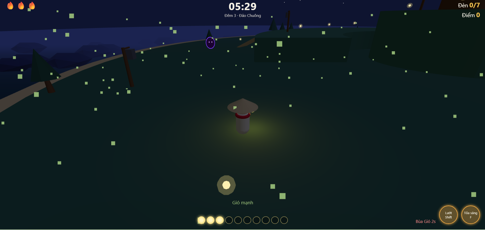

# Bằng chứng Phase 2 (Ticket-02, Contract v1.1)

Máy: Intel i5-11400H, Windows 11, Node 22.21.0. Tiêu chí P1–P18 và F1–F8 lấy từ [spec-phase-2.md](../../notes/spec-phase-2.md).

## Test tự động: `npm test` → 60/60 đạt

Danh sách đầy đủ: [test-output.txt](test-output.txt). Mỗi nhóm `describe` mang mã tiêu chí tương ứng.

| # | Tiêu chí | Kết quả |
|---|---|---|
| P1 | Contract v1.1, tuning = số chuẩn | Đạt |
| P2 | Chạy 6 m/s, nhảy 7 m/s g=20, chỉ nhảy khi chạm đất | Đạt |
| P3 | Lướt 14 m/s × 12 tick, hồi chiêu 90 tick tính từ lúc bắt đầu, trên không giữ độ cao | Đạt |
| P4 | 20 đom đóm ở 20 điểm khác nhau, +1 ở tick 240; nhặt XZ ≤ 1.0 và chênh cao ≤ 1.5; sức chứa 10 | Đạt |
| P5 | Đèn 10, nạp nhiều lần, bán kính 2.0, bằng nhau chọn id nhỏ; +10/đom đóm nạp, +100/đèn | Đạt |
| P6 | Chỉ đèn đã sáng chặn Bóng Mực ở 6 m; Bóng Mực đang ở trong bị đẩy ra trong 30 tick và không gây sát thương | Đạt |
| P7 | Tỏa Sáng: 3 đom đóm, bán kính 3D 5 m, hồi chiêu 180, choáng 120, đẩy 4 m/15 tick, pulse lại làm mới, +5 | Đạt |
| P8 | Sinh Bóng Mực ở tick 300 (2 con) rồi mỗi 480 tick; `spawning`; phát hiện 12 m; 4 / 4.5 m/s | Đạt |
| P9 | Bị đánh: −1 lửa, rơi floor(n/2) đom đóm ra vành 1.5–2.5 m, TTL 8 s, bất tử 90 tick, `recoil`, tối đa 1 hit mỗi tick | Đạt |
| P10 | Rơi khỏi đảo: −1 lửa, `lost`, chờ 60 tick, hồi sinh có bất tử; hết lửa thì thua ngay | Đạt |
| P11 | Thắng (kể cả đúng tick hết giờ), `dawn`, điểm thưởng ×2 | Đạt |
| P12 | Đêm 2: cầu, bục nhảy (đáp sau 80–90 tick ở đảo B); Đêm 3: vách, dốc lên tầng 1, bục lên tầng 2, tháp chặn | Đạt |
| P13 | Gió Lạc: idle → chase → cướp 3 → flee 240 → removed; Tỏa Sáng làm flee hoặc thả đồ | Đạt |
| P14 | Bùa Gió: 600 tick, 7.2 m/s, lướt không hồi chiêu, nhấn khi đang lướt bị bỏ qua, xuất hiện lại sau 45 s | Đạt |
| P15 | Gió Đêm 3: tick 1800–2099, 2 m/s | Đạt |
| P16 | Tạm dừng: `tick` tăng, `sim_tick`/thời gian đứng yên, `paused/resumed` | Đạt |
| P17 | Snapshot đủ trường v1.1; `--night 1/2/3`; tất định cho cả 3 đêm | Đạt |
| P18 | Một đêm đầy đủ ≤ 30 s | Đạt (xem dưới) |

Để chắc test không phải lúc nào cũng đạt: trong lúc viết test, có 4 test đỏ khi chạy lần đầu. Ba test do tôi kỳ vọng sai, một test do kịch bản không hợp lý. Tôi sửa test, không sửa luật cho khớp test; chi tiết ở [ai-log.md](../../notes/ai-log.md).

## Hiệu năng (P18): [perf.txt](perf.txt)

Đêm đủ dài, tắt Bóng Mực để không ai chết sớm ([no-shades.scenario.json](no-shades.scenario.json)):

| Đêm | Tick | Thời gian |
|---|---|---|
| 1 | 18 000 | 402 ms |
| 2 | 19 800 | 426 ms |
| 3 | 21 600 | 464 ms |

Thời gian đã tính cả khởi động node + tsx. Test CLI cũng tự kiểm tra Đêm 3 đủ 21 600 tick chạy < 30 s.

## Chơi từ đầu tới thắng (bot)

[scripts/autoplay.ts](../../../scripts/autoplay.ts) chơi bằng `Game` thật và ghi file inputs; chạy lại file đó bằng `headless_cmd` cho cùng kết quả.

- **Đêm 1, seed 1: thắng** ở tick 12 987, 1276 điểm, còn 2 lửa ([inputs](autoplay-n1-seed1.inputs.json), [output](autoplay-n1-seed1.out.jsonl)). Điểm khớp công thức: 50×10 + 5×100 + floor(83.55)×2 + 2×50 + 2 lần trúng Tỏa Sáng ×5 = 1276.
- **Chưa đạt:** với số chuẩn, bot chỉ thắng 1/5 seed ở Đêm 1 và **0/5 ở Đêm 2, 0/5 ở Đêm 3**. Bot né Bóng Mực và tìm đường (cầu, dốc, bục) còn vụng; trên Đêm 3 bot hay kẹt sát vách. Đây là giới hạn của bot, không phải lỗi luật (luật đã được 60 test kiểm). Vì vậy Đêm 2 và 3 chưa có bằng chứng tự động "thắng từ đầu tới cuối", mà cần chơi tay.

## Phần 3: tính năng (F1–F8)

Ảnh chụp tự động bằng Chrome headless (`?night=N` vào thẳng một đêm), không có lỗi JavaScript trong console:

| Ảnh | Cho thấy |
|---|---|
|  | F3: menu chính (Bắt đầu / Cài đặt, bảng phím) |
|  | Đêm 1 với HUD chuẩn (F7): lửa trên trái, `mm:ss` trên giữa, đèn `k/n` và điểm trên phải, thanh 10 ô dưới giữa, 2 icon hồi chiêu dưới phải |
|  | Đêm 2: đảo A, bục nhảy vàng, đèn L1 |
|  | Đêm 3: tầng 1 (nửa vành khăn), tầng 2, mũi tên chỉ đèn chưa sáng ở ngoài màn hình (F7) |

| # | Tính năng | Kết quả |
|---|---|---|
| F1 | Gió Lạc (dải lụa #8FA3B8) | Luật: đạt (P13). Hiển thị: **chưa kiểm bằng mắt** |
| F2 | Bùa Gió (đỏ #C8102E viền vàng) | Đạt: luật (P14) + chơi tay (thấy lá bùa trên cầu, HUD hiện "Bùa Gió 2s") |
| F3 | Menu → giới thiệu (lời Ông Đăng) → chơi → kết quả → đêm sau → Bình Minh; thua thì chơi lại | Menu và giới thiệu Đêm 1: đạt (chơi tay). Màn kết quả, chuyển đêm, Bình Minh: **chưa kiểm** |
| F4 | Tạm dừng Esc/P: Tiếp tục / Chơi lại Đêm / Cài đặt / Về menu | Đạt: logic (P16) + chơi tay (menu đủ 4 nút, đồng hồ đứng yên) |
| F5 | Cài đặt âm lượng, độ nhạy chuột, lưu localStorage | Màn cài đặt có 2 thanh trượt: đạt (chơi tay). Giữ giá trị sau khi tải lại trang: **chưa kiểm** |
| F6 | Nhạc nền + 12 hiệu ứng (WebAudio tổng hợp) | Đạt: người chơi thử đã nghe nhạc và hiệu ứng, xác nhận ổn |
| F7 | HUD đầy đủ | Đạt (ảnh headless + chơi tay: mũi tên, hồi chiêu, thời gian bùa, báo gió). Đồng hồ đỏ nhấp nháy ≤ 30 s: **chưa chụp** |
| F8 | Bảng màu chuẩn, ánh sáng môi trường = 0.15 + 0.55 × tỉ lệ | Các mã hex lấy từ `src/render/palette.ts`; công thức ở `ambientFor()` |

### Chơi tay trên trình duyệt (`npm run dev`)

| Ảnh | Cho thấy |
|---|---|
|  | F4: Đêm 1 đang tạm dừng, 2/5 đèn, 400 điểm; Bóng Mực có viền #7A3CFF |
|  | Đêm 2: cầu tre, Bùa Gió đỏ viền vàng, bục nhảy vàng, icon hồi chiêu Lướt đang chạy, mũi tên chỉ đèn |
|  | F3: menu chính |
|  | F3: giới thiệu Đêm 1, tên đảo + lời Ông Đăng |
|  | F5: cài đặt âm lượng và độ nhạy chuột |
|  | Đêm 3: cơn gió (lá bay, chữ "Gió mạnh"), "Bùa Gió 2s", tầng 1 và tầng 2 phía sau |

Sửa sau khi chơi tay: đèn đã sáng trông gần trắng (lớp phát sáng màu lõi #FFE9B0 quá mạnh), nên đổi lớp phát sáng sang #FFB347 với cường độ 0.75.

## Hồi quy Phase 1

- Test Phase 1 được **viết lại theo số chuẩn**, không tắt test nào. Các test dùng số tự chọn của Phase 1 (lantern_cost 5, cộng điểm khi nhặt, vùng an toàn cho cả đèn chưa thắp, mép đảo là tường) đã đổi kỳ vọng vì Ticket-02 thay các luật đó.
- Những luật Phase 1 vẫn giữ (mô hình tick, snapshot tick 0, `--ticks N` đúng N bước, giữ giá trị input, chuẩn hóa `move`, xoay `cam_yaw_deg`, scenario không phát sự kiện, exit 2) vẫn có test và vẫn đạt.
- Bằng chứng trong `docs/proof/phase-1/` ứng với code ở tag `phase-1` (số v1.0), không chạy lại được với code hiện tại. Đó là chủ ý, vì số liệu đã đổi.
