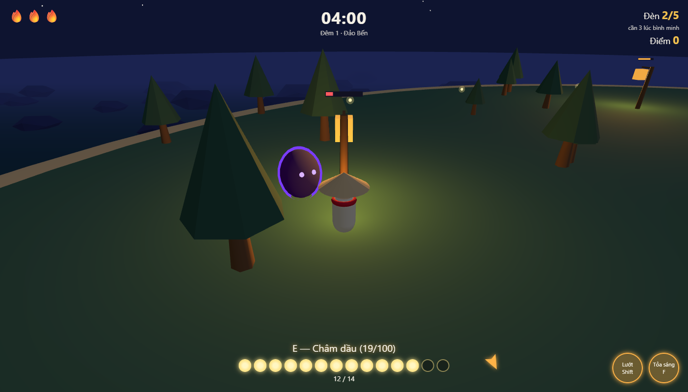
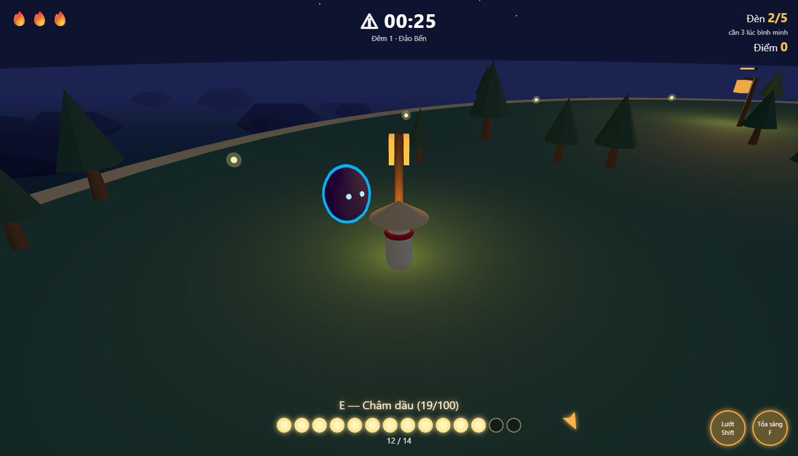
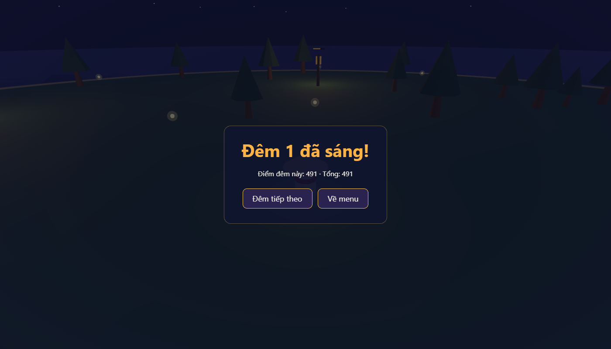
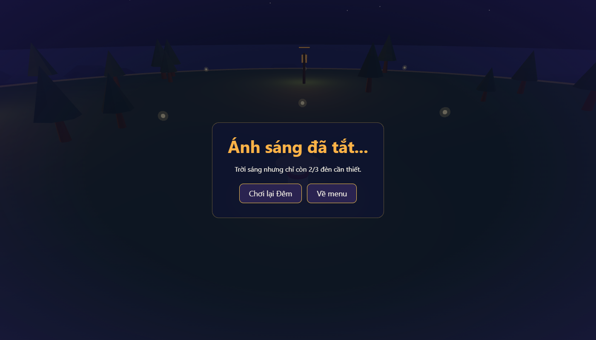

# Bằng chứng Phase 3 (Ticket-03 "Đèn cạn dầu", Contract v1.2)

Thiết kế: [ADR 0001](../../adr/0001-lantern-fuel-and-dawn-win.md) · Breaking changes: [CHANGELOG](../../../CHANGELOG.md) · Máy: Intel i5-11400H, Node 22.21.0.

## Test tự động: `npm test` → 84/84 đạt

Danh sách: [test-output.txt](test-output.txt). Test mới nằm trong [tests/fuel.test.ts](../../../tests/fuel.test.ts) (21 test).

| Mục Ticket-03 | Test | Kết quả |
|---|---|---|
| §1 Dầu: thắp mới 100, hao 1/s, tắt ở 0 (`lantern_out`, `deposited` 0, `ever_lit` giữ), châm dầu `min(n, ceil((100-fuel)/10))`, đèn đầy không được chọn, thắp lại cần 5, dầu tính nguyên 1/60 (sau 3000 tick đúng 50.0) | F-FUEL (7 test) | Đạt |
| §2 Vùng an toàn chỉ khi `fuel >= 30`; Bóng Mực `wander` tới đèn yếu, `drain` 5/s cộng dồn, `fuel_drain` mỗi 60 tick; `drain` → `chase` (≤ 6 m) / `wander` (đèn tắt, châm ≥ 30); châm ≥ 30 đẩy Bóng Mực ra mép trong 30 tick, không gây sát thương | F-SAFE, F-DRAIN (7 test) | Đạt |
| §3 Không thắng sớm; thắng `dawn_survived` khi ≥ ceil(0.6 × n) đèn sáng ở tick cuối (3/5, 4/6, 5/7); đèn tắt đúng tick bình minh không tính; hết lửa ở tick cuối → `no_flames`; thời lượng 240/270/300 | F-WIN (7 test) | Đạt |
| §4 Sức chứa `min(20, 10 + 2 × lần thắp)`, thắp lại cũng tính, đèn đặt sẵn bằng scenario không tính | F-CAP (2 test) + F-FUEL | Đạt |
| §5 Điểm: +5/đom đóm nạp, +100 thắp mới, +40 thắp lại, +5 hoặc +15 (đang `drain`) khi trúng Tỏa Sáng, bình minh +50 + floor(fuel)/đèn và +50/lửa, bỏ thưởng thời gian | F-FUEL, F-DRAIN, F-WIN, P5 | Đạt |
| §7 Contract v1.2: `tuning`, snapshot (`fuel` 1 chữ số thập phân, `ever_lit`, `relit_count`, `capacity`, trạng thái `drain`), scenario (`fuel`, `ever_lit`, `successful_lights`, `target_lantern_id`), sự kiện mới | contract.test + F-* | Đạt |
| §6 Mù màu: cài đặt được lưu | settings.test (lưu `colorblind`) | Đạt |

Để chắc test không phải lúc nào cũng đạt, tôi cố tình làm hỏng code: bỏ ngưỡng thắng thì 4 test đỏ, bỏ hao dầu thì 8 test đỏ. Sau đó code được trả về nguyên trạng.

## Hồi quy: test cũ bị luật mới thay

Sau khi sửa luật và **trước khi** sửa test, có **đúng 5 test cũ đỏ**. Tôi sửa hoặc xóa từng test, không skip test nào:

| Test cũ | Xử lý | Lý do |
|---|---|---|
| `declares contract 1.1` | Sửa thành 1.2 | §7 nâng contract |
| `tuning equals the Ticket-02 standard table` | Sửa: thời lượng 240/270/300, thêm khóa dầu, bảng điểm mới | §3, §5, §7 |
| P5 `... +10/mote, +100/lantern` | Sửa kỳ vọng thành +5/đom đóm | §5 |
| P11 `lighting the last lantern wins ...` | **Xóa** | §3: không còn thắng sớm, không còn thưởng thời gian. Thay bằng F-WIN |
| P11 `winning on the exact time-out tick still wins` | **Xóa** | Như trên. Trường hợp "đúng tick cuối" được test lại bằng luật mới ở F-WIN |

Các test Phase 1–2 không bị thay thế (mô hình tick, di chuyển, lướt, nhảy, rơi, Gió Lạc, Bùa Gió, gió, tạm dừng, bản đồ, CLI, exit 2, hiệu năng) vẫn đạt nguyên vẹn.

## Chơi được tới bình minh (bot)

Bot ([scripts/autoplay.ts](../../../scripts/autoplay.ts)) đổi mục tiêu cho hợp luật mới: thắp đèn tắt, châm dầu đèn yếu, tỏa sáng dẹp đường khi mang đom đóm tới đèn. Chạy lại file inputs của bot bằng `headless_cmd`:

- **Đêm 1, seed 1: thắng `dawn_survived`** ở tick 14 400 (= 240 s), 1038 điểm ([inputs](autoplay-n1-seed1.inputs.json), [output](autoplay-n1-seed1.out.jsonl)). Log cho thấy đủ vòng đời đèn: thắp L3, L4 → cả hai cạn dầu (`lantern_out` ở tick 7095, 9750) → **thắp lại** (`relight: true`) → thắp L1 → 3/5 đèn sáng lúc bình minh.
- **Chưa đạt:** bot thắng 1/5 seed ở Đêm 1, **0/5 ở Đêm 2 và 0/5 ở Đêm 3** (tìm đường và né vẫn còn vụng, như Phase 2).

## Hiệu năng: [perf.txt](perf.txt)

Một đêm đầy đủ (tắt Bóng Mực để không chết sớm) chạy hết 328 / 385 / 434 ms cho Đêm 1 / 2 / 3. Hai lần chạy seed 4, Đêm 2, đủ 21 600 tick cho kết quả giống hệt.

| Ảnh | Cho thấy |
|---|---|
|  | §1 thanh dầu: L2 dầu 19 (thanh đỏ, ngắn) có Bóng Mực đang `drain` bên cạnh; L1 ở xa thanh dài; L3 đã từng sáng nay tắt (xẹp, giấy rách). HUD: "E — Châm dầu (19/100)", sức chứa **12 / 14** (2 lần thắp), "cần 3 lúc bình minh" |
|  | §6 mù màu (`&cb`): viền và mắt Bóng Mực **#00B3FF**, đồng hồ cảnh báo **trắng kèm ⚠** khi ≤ 30 s. Ảnh này chụp đúng nhịp tắt của chu kỳ nhấp nháy 1 Hz nên thanh dầu L2 bị ẩn |
|  | §3 thắng ở bình minh: 491 = 3 × 50 + (63 + 39 + 89) dầu + 3 × 50 lửa |
|  | §3 thua: chỉ 2 đèn sáng, dưới ngưỡng 3 |

