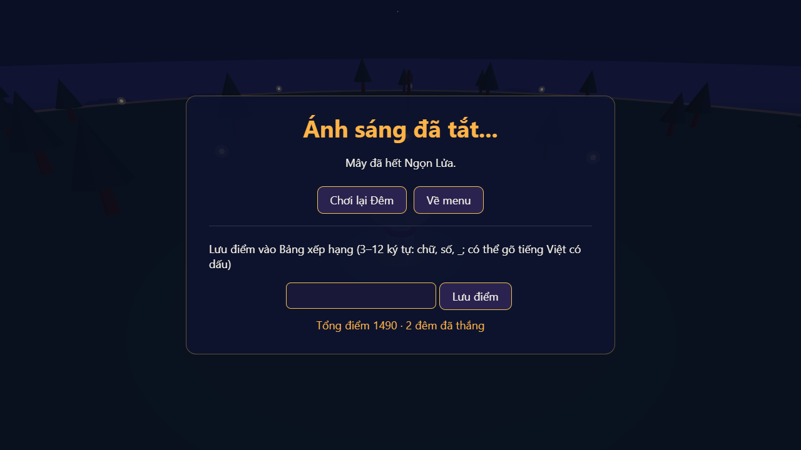
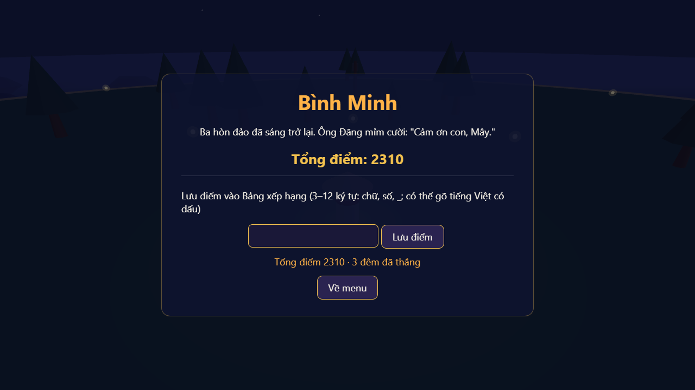
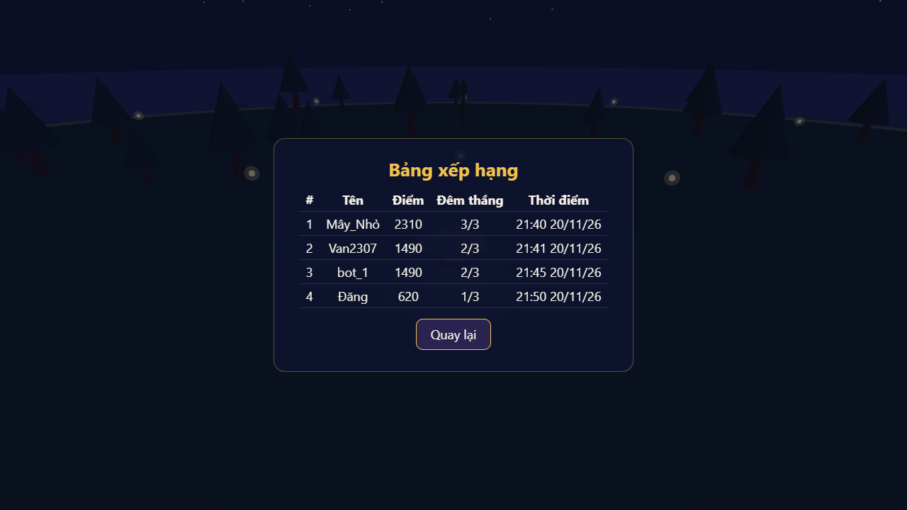
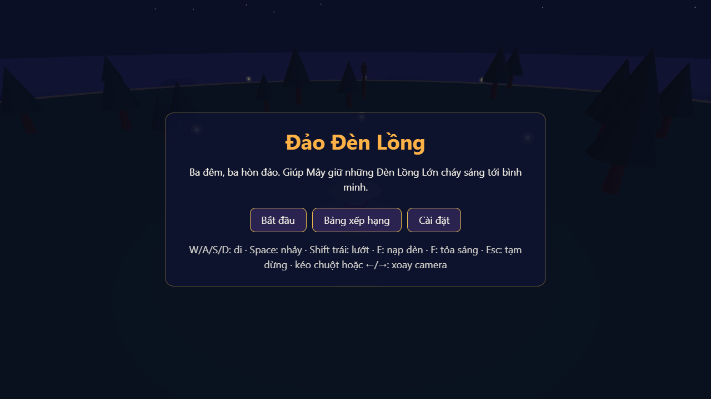
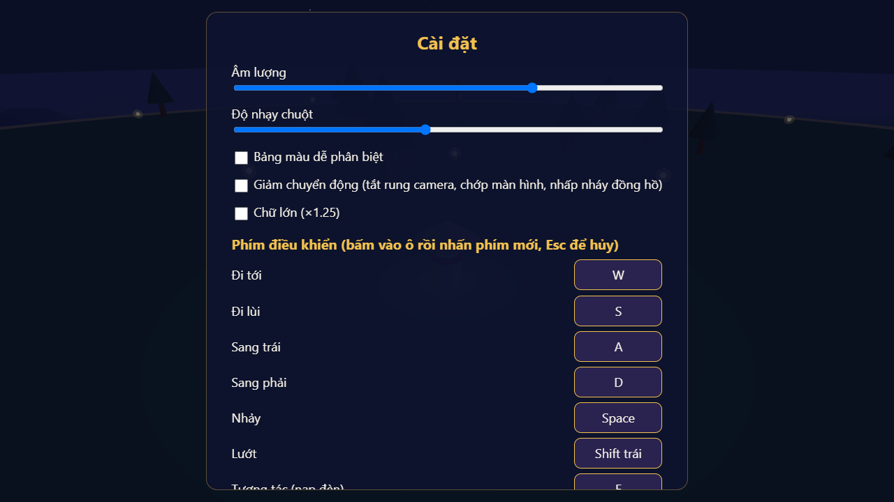
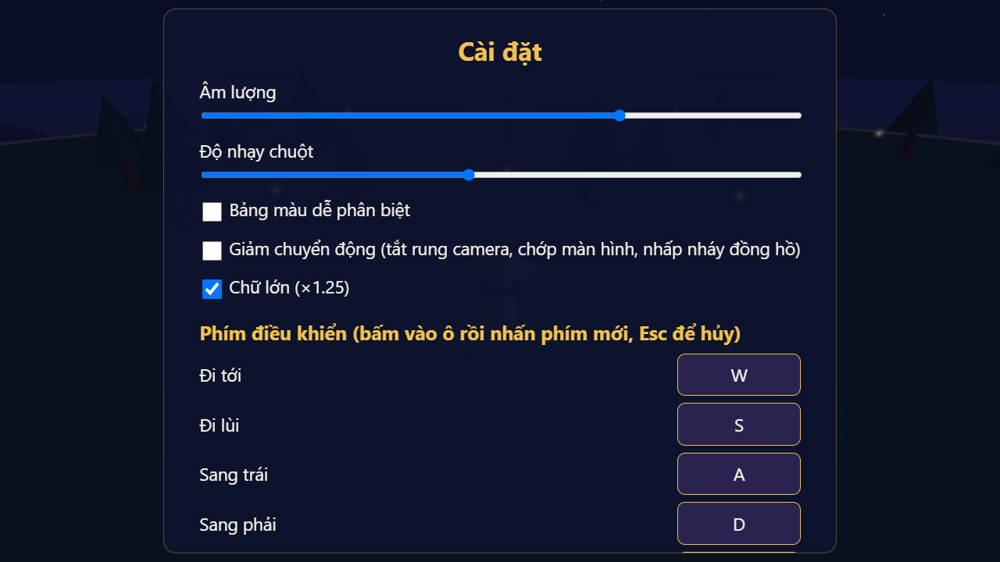
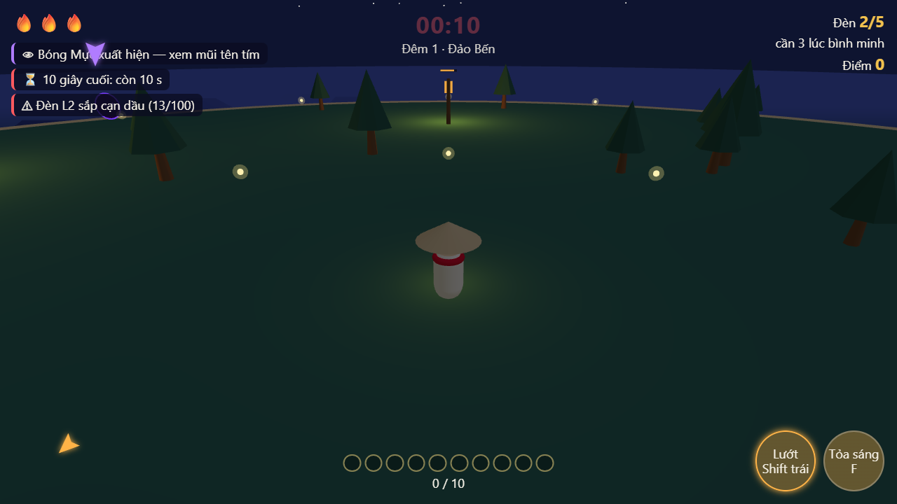
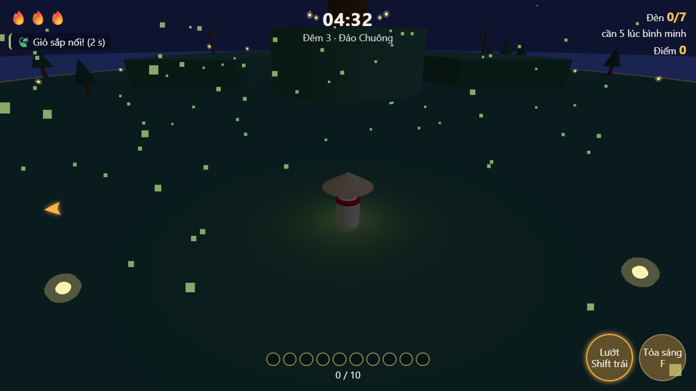
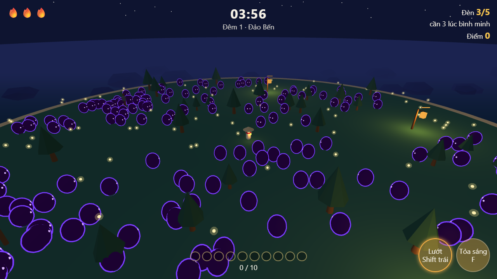

# Bằng chứng Phase 4 (v1.0.0, Contract v1.3)

Thiết kế: [ADR 0002](../../adr/0002-bench-soak-leaderboard.md) · [CHANGELOG](../../../CHANGELOG.md) · Máy tự đo: Intel i5-11400H, GPU tích hợp Intel UHD, Windows 11, Node 22.21.0, Chrome 157.

## Tổng hợp

| Yêu cầu | Bằng chứng | Kết quả |
|---|---|---|
| §1 Benchmark: lệnh, cảnh chuẩn, công thức, thoát mã 0 | [bench.json](../../../bench.json), test P4-BENCH / P4-STATS, [ảnh cảnh bench](screenshots/bench-scene.png) | **Đạt trên máy tôi**: avg **135 fps** (≥ 60), 1% low **44.5 fps** (≥ 30), load **1 620 ms** (≤ 10 000). Số chính thức đo trên máy chấm |
| §2 Soak 10 Đêm, 1 tiến trình | [soak.json](../../../soak.json), test P4-SOAK | **Đạt**: 0 crash, RAM 73.2 → 79.5 MB (×1.09 ≤ ×1.2) |
| §3 Bảng xếp hạng | test P4-BOARD, thử API thật, ảnh | **Đạt** |
| §4 Đổi phím, phụ đề, giảm chuyển động, cỡ chữ | test P4-ACCESS + settings, ảnh | **Đạt** (xem mục "Chưa kiểm" ở cuối) |
| §5 Đóng gói, tài liệu | [README](../../../README.md), [CHANGELOG](../../../CHANGELOG.md), [CREDITS](../../../CREDITS.md), [LICENSE](../../../LICENSE) | README, CHANGELOG, CREDITS, LICENSE: **Đạt**. Release v1.0.0: **chưa đạt** (tạo trên GitHub khi nộp) |
| §6 Contract v1.3 (`contract_version`, `bench_cmd`, `soak_cmd`, giữ v1.0–v1.2) | contract.test, P4-HEADLESS | **Đạt** |
| §7 Retro, video demo | [docs/notes/retro.md](../../notes/retro.md) | Retro: có bản nháp (cần điền token/chi phí). Video: **chưa đạt** |

## Test tự động: `npm test` → 104/104 đạt

Danh sách: [test-output.txt](test-output.txt). Có 20 test mới trong [tests/phase4.test.ts](../../../tests/phase4.test.ts):

| Nhóm | Kiểm tra |
|---|---|
| P4-BENCH | Đúng 200 Bóng Mực `wander` (id không trùng) và 100 đom đóm; L1–L3 sáng với dầu 100, L4–L5 tắt; rải khắp đảo (mỗi góc phần tư > 30 con), cùng seed thì giống hệt, khác seed thì khác. Chạy 300 s (dài hơn Đêm 1): không có sự kiện nào, không kết thúc, vẫn 200/100, lửa 3, không nhặt kể cả khi đặt đom đóm và Bóng Mực ngay chân Mây, dầu giữ 100, mọi con vẫn `wander` và > 150 con đã di chuyển. Camera ở (30,15,0) lúc 0 s, (0,15,30) lúc 3.75 s (ngược chiều kim đồng hồ khi nhìn từ trên, theo quy ước góc của bản đồ), về chỗ cũ lúc 15 s |
| P4-STATS | `avg = 1000N/Σdt`; 1% low với `k = max(1, ceil(0.01N))` (thử N = 100 → k = 1 và N = 150 → k = 2); p95 |
| P4-SOAK | Đêm xoay 1 → 2 → 3 → 1; đổi hướng đúng mỗi 30 tick; tần suất nút ≈ 5/3/2/10 % (60 000 mẫu); một Đêm soak tất định; chạy đúng `soak_cmd` từ contract: mã 0, 0 crash, RAM ≤ ×1.2 |
| P4-HEADLESS | Chạy lại inputs của bot Phase 3 cho ra **giống từng byte** file output Phase 3 đã commit: thêm cờ bench không làm đổi đầu ra headless |
| P4-BOARD | Tên 3–12 ký tự `[A-Za-z0-9_]`, nhận `Mây`, `Nguyễn_Văn`, `Đăng`, từ chối `ab`, `a b c`, `abc!`, chữ không phải Latin; xếp điểm giảm dần, bằng điểm thì ai đạt trước lên trên (so được cả các múi giờ khác nhau); chỉ giữ top 10; `achieved_at` theo ISO 8601 có múi giờ; bỏ qua mục hỏng; export có dạng `{"entries": [...]}` đúng thứ tự; chạy thật `npm start -- --export-leaderboard` đọc file trên đĩa |
| P4-ACCESS | Đủ hành động đổi được phím; gán trùng bị từ chối và báo tên hành động đang giữ phím đó; phím mặc định không bị sửa (Khôi phục mặc định hoạt động); **mọi `font-size` trong CSS ≥ 18 px hoặc ≥ 1 rem**, gốc 18 px, chữ lớn 22.5 px |

Để chắc test không phải lúc nào cũng đạt, tôi cố tình bỏ `|| this.bench` ở bước nhặt đom đóm: test P4-BENCH đỏ. Sau đó trả file về nguyên trạng (đã so khớp với bản sao lưu bằng `cmp`).

## Hồi quy: test cũ bị Phase 4 thay

Chạy test **trước khi** sửa test thì có **đúng 4 test cũ đỏ**. Tôi sửa cả 4, không skip test nào:

| Test cũ | Xử lý | Lý do |
|---|---|---|
| `declares contract 1.2 and the commands` | Sửa thành 1.3, kiểm thêm `bench_cmd`, `soak_cmd` | §6 |
| settings: `defaults when nothing is saved` | Kỳ vọng so với cả object `DEFAULTS` | §4: Settings có thêm `reducedMotion`, `largeText`, `keys` |
| settings: `saved ... are loaded again` | Lưu rồi đọc lại cả 3 trường mới (gồm một phím đã đổi) | §4 phải được lưu |
| settings: `corrupt or out-of-range values fall back safely` | Kỳ vọng so với object đầy đủ | Như trên |

Mọi test luật game Phase 1–3 vẫn đạt nguyên vẹn, không phải sửa.

## §1 Benchmark

```
npm run bench -- --seed 42 --duration 30 --out bench.json   → exit 0
```

[bench.json](../../../bench.json): `avg_fps` 135, `p1_low_fps` 44.5, `frame_ms_p95` 11.9, `frames` 4051, `load_ms` 1620, `peak_mem_mb` 992, `vsync_off` true, 35 draw call và khoảng 200k tam giác mỗi khung.

- **Vsync tắt**: dùng cờ Chrome `--disable-gpu-vsync --disable-frame-rate-limit`. Trung bình 135 fps, cao hơn hẳn 60 Hz của màn hình, chứng tỏ không bị khóa nhịp.
- **Cửa sổ thật** (không headless), vùng vẽ đúng 1280×720 (`viewport 1280x720` ghi trong `renderer`), tỉ lệ điểm ảnh 1.
- **`peak_mem_mb` = 992 MB** là tổng RSS của *cả cây tiến trình Chrome* (browser, GPU, renderer, các tiến trình phụ), vì bản web không có một tiến trình game riêng. Riêng renderer chỉ chiếm vài trăm MB.

### Tối ưu (chỉ phần hiển thị, luật không đổi)

| Lần đo (cửa sổ thật, 30 s) | avg | 1% low | p95 |
|---|---|---|---|
| Ban đầu: mỗi Bóng Mực là 5 mesh riêng | 85.1 | **21.5** ✗ | 25.2 ms |
| + `InstancedMesh` cho Bóng Mực và đom đóm | 67.3 | 23.8 ✗ | 30.9 ms |
| + gộp cây/mây/cầu, Lambert, **HUD chỉ ghi DOM khi giá trị đổi** | **135** | **44.5** ✓ | 11.9 ms |

Đo từng phần trong khung hình (bench in ra stderr) cho thấy mô phỏng chỉ tốn 0.2 ms, còn `render()` thì 12 ms và có đỉnh 25 ms. Giảm độ phân giải xuống ½ hay tắt khử răng cưa gần như không đổi gì, tức không phải nghẽn điểm ảnh. Bỏ phần trang trí thì p95 giảm mạnh, tức chi phí nằm ở số draw call. Thủ phạm lớn nhất lại là HUD: mỗi khung nó gán lại `textContent`, `innerHTML` và style dù giá trị không đổi, khiến trình duyệt tính lại style và layout. Chỉ ghi khi giá trị thay đổi là 1% low tăng từ 21 lên hơn 44.

## §2 Soak

```
node --expose-gc --import tsx src/headless/soak.ts --seed 7 --nights 10 --out soak.json   → exit 0
```

[soak.json](../../../soak.json): `crashes` 0, `mem_start_mb` 73.2, `mem_end_mb` 79.5 (×1.09). Cả 10 Đêm đều `lost`: input ngẫu nhiên nhảy và lướt bừa nên rơi khỏi đảo hoặc bị Bóng Mực chạm hết 3 lửa trong vài giây. Vì vậy tổng thời gian chỉ khoảng 0.3 s. Đây là kết quả đúng của input ngẫu nhiên theo đề, không phải lỗi.

## §3 Bảng xếp hạng

Ngoài unit test, tôi thử trên server preview thật, với `DDL_DATA_DIR` trỏ vào thư mục tạm để không đụng vào dữ liệu thật:
- POST `Van2307` 1490 (21:41) rồi `bot_1` 1490 (21:45): file trên đĩa xếp `Van2307` trước, vì bằng điểm thì ai đạt trước đứng trên.
- Tên `x!` bị từ chối (HTTP 400). `Mây_Nhỏ` và `Đăng` được lưu đúng UTF-8 (`ỏ` = U+1ECF, `Đ`, `ă`).
- `npm start -- --export-leaderboard out.json` cho ra `{"entries": [...]}` đúng thứ tự.

| Ảnh | Cho thấy |
|---|---|
|  | Thua một Đêm → ô nhập tên, tổng điểm và số Đêm đã thắng |
|  | Sau Bình Minh → ô nhập tên |
|  | Màn Bảng xếp hạng (mở từ menu) đọc từ file trên đĩa; dữ liệu là các mục thử ở trên, kể cả tên tiếng Việt |
|  | Menu có nút **Bảng xếp hạng**; dòng hướng dẫn phím lấy theo phím đang gán |

## §4 Dễ tiếp cận

| Ảnh | Cho thấy |
|---|---|
|  | Cài đặt: Giảm chuyển động, Chữ lớn, bảng đổi phím (11 hành động: 4 hướng, nhảy, lướt, tương tác, tỏa sáng, tạm dừng, xoay camera trái/phải), nút Khôi phục mặc định (cuộn xuống) |
|  | Chữ lớn ×1.25 |
|  | Chụp theo thời gian thực sau 6 s: phụ đề "Bóng Mực xuất hiện" kèm **mũi tên tím** chỉ vào con vừa sinh, "10 giây cuối", "Đèn L2 sắp cạn dầu (13/100)". Phím trên ô hồi chiêu lấy theo phím đang gán |
|  | Đêm 3, 2 s trước cơn gió đầu tiên: phụ đề "Gió sắp nổi! (2 s)" và lá bay |
|  | Cảnh benchmark: 200 Bóng Mực, 100 đom đóm, L1–L3 sáng |

Ảnh chụp bằng Chrome headless. Hai ảnh phụ đề và ảnh cảnh bench được chụp qua DevTools sau đúng N giây thật, vì cờ `--virtual-time-budget` không cho vòng `requestAnimationFrame` chạy đủ thời gian.

## Chưa đạt / chưa kiểm

- **Release v1.0.0 trên GitHub và video demo**: chưa có. Máy không có `gh`, nên phải tạo Release trên web và tự quay video. Đã build sẵn file zip bản web tĩnh.
- **Chưa kiểm bằng tay**: thao tác đổi phím bằng bàn phím thật (bấm ô → nhấn phím → thông báo trùng), và cảm giác của Giảm chuyển động (rung camera, chớp màn hình). Logic có unit test, nhưng chưa có người chơi thử.
- **Cỡ chữ**: test kiểm mọi `font-size` khai trong CSS. Riêng emoji 🔥 và chữ trong canvas 3D thì không có.
- Số bench là đo trên máy tôi. Theo đề, số chính thức đo trên máy chấm.
